# ERD — Hamzah Style (Website Batik)

Sumber: seluruh file di `database/migrations/` (16 file migration → **19 tabel**: 12 tabel domain + 7 tabel framework Laravel). Kolom, tipe, dan perilaku relasi di bawah ini diturunkan langsung dari kode migration — termasuk kolom dual EN/ID (legacy) dan penambahan lewat migration alter.

## Diagram (mermaid)

```mermaid
erDiagram
    users ||--o{ products : "admin_id cascadeOnDelete"
    users ||--o{ addresses : "user_id cascadeOnDelete"
    users ||--o{ orders : "user_id cascadeOnDelete"
    users ||--o{ cart_items : "user_id cascadeOnDelete (nullable)"
    users ||--o{ reviews : "user_id nullOnDelete (nullable)"
    users ||--o{ personal_access_tokens : "tokenable morphs"
    categories ||--o{ products : "category_id nullOnDelete"
    products ||--o{ order_items : "product_id nullOnDelete"
    products ||--o{ cart_items : "product_id cascadeOnDelete"
    products ||--o{ reviews : "product_id cascadeOnDelete"
    orders ||--|{ order_items : "order_id cascadeOnDelete"
    orders ||--o{ payments : "order_id cascadeOnDelete"
    orders ||--o| shipments : "order_id cascadeOnDelete"
    orders ||--o{ reviews : "order_id nullOnDelete (nullable)"

    users {
        bigint id PK
        string name
        string email UK
        string google_id UK "nullable (alter 2026-11-06)"
        string avatar "nullable"
        string phone "nullable"
        string role "default 'customer', index"
        string password "nullable (Google login)"
        timestamp email_verified_at
    }
    categories {
        bigint id PK
        string name
        string nama_kategori "alias ID"
        string slug UK
        text description
        text deskripsi "alias ID"
        string image
        string gambar "alias ID"
    }
    products {
        bigint id PK
        bigint admin_id FK "users, cascadeOnDelete, nullable"
        bigint category_id FK "categories, nullOnDelete, nullable"
        bigint kategori_id "legacy, tanpa FK"
        string name
        string sku UK
        string category "nama kategori (legacy)"
        decimal price "default 0"
        int stock "default 0"
        string status "default 'Tersedia'"
        json size_stock "stok per ukuran"
        string image
        json other_images
        text description
        string material
        string size
    }
    addresses {
        bigint id PK
        bigint user_id FK "users, cascadeOnDelete"
        string label "default 'Rumah'"
        string recipient_name "nullable"
        string phone "nullable"
        text full_address "nullable"
        string city "nullable"
        string province "nullable"
        bigint province_id "nullable (RajaOngkir, alter)"
        bigint city_id "nullable (RajaOngkir, alter)"
        string postal_code "nullable"
        bool is_primary "default false"
    }
    orders {
        bigint id PK
        bigint user_id FK "users, cascadeOnDelete"
        string code UK
        string customer_name
        text address
        string phone
        decimal total_price
        decimal shipping_cost "default 0"
        string midtrans_order_id UK "nullable"
        string snap_token "nullable"
        string payment_status "default 'pending', index"
        string payment_type "nullable"
        string transaction_id "nullable"
        timestamp paid_at
        timestamp payment_deadline "index"
        json raw_notification "nullable"
        string payment_method "default 'Transfer Bank'"
        string payment_proof "nullable"
        string status "default 'Belum Dibayar'"
        string tracking_number "nullable"
    }
    order_items {
        bigint id PK
        bigint order_id FK "orders, cascadeOnDelete"
        bigint product_id FK "products, nullOnDelete, nullable"
        bigint produk_id "legacy, tanpa FK"
        string product_name "nullable"
        decimal price "default 0"
        int quantity "default 1"
        decimal subtotal "default 0"
    }
    cart_items {
        bigint id PK
        bigint user_id FK "users, cascadeOnDelete, nullable"
        string session_id "index, nullable"
        bigint product_id FK "products, cascadeOnDelete"
        string size "nullable"
        string variant "nullable"
        int quantity "default 1"
        bool selected "default true"
    }
    payments {
        bigint id PK
        bigint order_id FK "orders, cascadeOnDelete"
        string midtrans_order_id UK "nullable"
        string snap_token "nullable"
        text snap_redirect_url "nullable"
        string status "default 'pending', index"
        string status_pembayaran "default 'Menunggu Pembayaran'"
        string payment_type "nullable"
        string metode_pembayaran "nullable"
        string transaction_id "nullable"
        json payment_details "nullable"
        decimal gross_amount "default 0"
        decimal jumlah_bayar "default 0"
        timestamp expires_at "nullable"
        timestamp paid_at "nullable"
        timestamp tanggal_bayar "nullable"
        json raw_notification "nullable"
        json payment_response "nullable"
    }
    shipments {
        bigint id PK
        bigint order_id FK "orders, cascadeOnDelete"
        string courier "default 'JNE Reguler'"
        string tracking_number "nullable"
        string no_resi "nullable"
        timestamp shipped_at "nullable"
        string shipping_status "default 'Menunggu Pengiriman'"
        text notes "nullable"
    }
    reviews {
        bigint id PK
        bigint product_id FK "products, cascadeOnDelete"
        bigint produk_id "legacy, tanpa FK"
        bigint order_id FK "orders, nullOnDelete, nullable"
        bigint user_id FK "users, nullOnDelete, nullable"
        string customer_name
        tinyint rating
        text comment
        string image_path "nullable"
        string status "default 'Menunggu'"
    }
    personal_access_tokens {
        bigint id PK
        string tokenable_type "morph"
        bigint tokenable_id "morph"
        string name
        string token UK
        text abilities "nullable"
        timestamp last_used_at "nullable"
        timestamp expires_at "nullable, index"
    }
    store_settings {
        bigint id PK
        string nama_toko "default 'Website Batik Official'"
        string kota_asal "default 'Kota Pekalongan'"
        string provinsi_asal "default 'Jawa Tengah'"
        string kode_pos_asal "default '51111'"
        text alamat_asal "nullable"
        string no_telepon_toko "nullable"
        string email_toko "nullable"
        text deskripsi_toko "nullable"
    }
```

## Catatan relasi (PK / FK / cascade)

| Relasi | FK | Perilaku (dari migration) |
|---|---|---|
| `users` → `products` | `products.admin_id` | `constrained('users')->cascadeOnDelete()` — hapus admin ikut menghapus produknya; nullable. |
| `users` → `addresses` | `addresses.user_id` | `cascadeOnDelete()` — alamat ikut terhapus bersama user. |
| `users` → `orders` | `orders.user_id` | `cascadeOnDelete()` — riwayat pesanan ikut terhapus bersama user. |
| `users` → `cart_items` | `cart_items.user_id` | `cascadeOnDelete()`, nullable (ada `session_id` untuk keranjang tamu). |
| `users` → `reviews` | `reviews.user_id` | `nullOnDelete()`, nullable — ulasan tetap ada walau user terhapus. |
| `users` → `personal_access_tokens` | `tokenable_type` + `tokenable_id` | `morphs('tokenable')` — token API Sanctum milik user. |
| `categories` → `products` | `products.category_id` | `nullOnDelete()` — produk tetap ada, kategori jadi NULL; nullable. |
| `products` → `order_items` | `order_items.product_id` | `nullOnDelete()` — riwayat item pesanan tidak ikut terhapus; nullable. |
| `products` → `cart_items` | `cart_items.product_id` | `cascadeOnDelete()` — produk dihapus → baris keranjang ikut terhapus. |
| `products` → `reviews` | `reviews.product_id` | `cascadeOnDelete()` — produk dihapus → ulasannya ikut terhapus. |
| `orders` → `order_items` | `order_items.order_id` | `cascadeOnDelete()` — hapus pesanan → semua item ikut terhapus. |
| `orders` → `payments` | `payments.order_id` | `cascadeOnDelete()`; tabel punya index komposit `(order_id, status)`. Relasi Eloquent: `hasMany` (banyak percobaan bayar) + `hasOne latestOfMany` untuk pembayaran aktif. |
| `orders` → `shipments` | `shipments.order_id` | `cascadeOnDelete()`; satu baris per pesanan (relasi `hasOne`). |
| `orders` → `reviews` | `reviews.order_id` | `nullOnDelete()`, nullable; **unique** `(order_id, product_id)` → maksimal 1 ulasan per produk per pesanan. |

Catatan lain:

- **Dual kolom EN/ID**: banyak tabel menyimpan pasangan kolom legacy (`name`/`nama`, `price`/`harga`, `stock`/`stok`, dst.). Aplikasi menulis/membaca kolom EN lebih dulu dan jatuh ke kolom ID sebagai fallback — tidak ada migrasi data yang menghapus kolom ID.
- **`store_settings`** dan framework tables tidak punya relasi FK ke tabel domain.
- **Migration alter**: `province_id`/`city_id` ditambahkan ke `addresses` (RajaOngkir, `2026_11_03`); `google_id`/`avatar` + `password` jadi nullable ditambahkan ke `users` (`2026_11_06`).

## Inventaris tabel vs file migration

| # | Tabel | File migration | Jenis |
|---|---|---|---|
| 1 | `users` | `0001_01_01_000000_create_users_table.php` + `2026_11_06_..._add_google_id...` | domain |
| 2 | `password_reset_tokens` | `0001_01_01_000000_create_users_table.php` | framework |
| 3 | `sessions` | `0001_01_01_000000_create_users_table.php` | framework |
| 4 | `cache` | `0001_01_01_000001_create_cache_table.php` | framework |
| 5 | `cache_locks` | `0001_01_01_000001_create_cache_table.php` | framework |
| 6 | `jobs` | `0001_01_01_000002_create_jobs_table.php` | framework |
| 7 | `job_batches` | `0001_01_01_000002_create_jobs_table.php` | framework |
| 8 | `failed_jobs` | `0001_01_01_000002_create_jobs_table.php` | framework |
| 9 | `categories` | `2026_09_16_000001_create_categories_table.php` | domain |
| 10 | `products` | `2026_09_16_000002_create_products_table.php` | domain |
| 11 | `addresses` | `2026_09_16_000003_create_addresses_table.php` + `2026_11_03_..._add_rajaongkir_ids...` | domain |
| 12 | `store_settings` | `2026_09_16_000004_create_store_settings_table.php` | domain |
| 13 | `orders` | `2026_09_16_000005_create_orders_table.php` | domain |
| 14 | `order_items` | `2026_09_16_000006_create_order_items_table.php` | domain |
| 15 | `cart_items` | `2026_09_16_000007_create_cart_items_table.php` | domain |
| 16 | `payments` | `2026_09_16_000008_create_payments_table.php` | domain |
| 17 | `shipments` | `2026_09_16_000009_create_shipments_table.php` | domain |
| 18 | `reviews` | `2026_09_16_000010_create_reviews_table.php` | domain |
| 19 | `personal_access_tokens` | `2026_11_12_032729_create_personal_access_tokens_table.php` | domain (Sanctum) |

**Total: 19 tabel dari 16 file migration** (12 domain + 7 framework).

## Ringkasan status penting (untuk laporan)

- `orders.status` (state machine pesanan, dijaga `Admin\OrderController::$allowedTransitions`):
  - `Belum Dibayar` → `Menunggu Pembayaran`, `Diproses`, `Dibatalkan`
  - `Menunggu Pembayaran` → `Diproses`, `Sudah Dibayar`, `Dibatalkan`
  - `Menunggu Konfirmasi` → `Menunggu Pembayaran`, `Diproses`, `Dibatalkan`
  - `Menunggu Verifikasi` → `Diproses`, `Sudah Dibayar`
  - `Sudah Dibayar` → `Diproses`
  - `Diproses` → `Dikirim`
  - `Dikirim` → `Selesai`
  - `Selesai`, `Batal`, `Dibatalkan` = status final (tanpa transisi keluar)
- `orders.payment_status`: `pending` → `paid` / `failed` / `cancelled` / `expired` (konstanta `Order::PAYMENT_*`).
- `payments.status`: `pending`, `paid`, `failed`, `cancelled`, `expired`, `replaced` (konstanta `Payment::STATUS_*`).
- `shipments.status_pengiriman`: `Menunggu Pengiriman` → `Diproses` → `Dikirim` → `Diterima`.
- `reviews.status`: `Menunggu` (default) / `Disetujui` — hanya ulasan `Disetujui` yang tampil publik.
